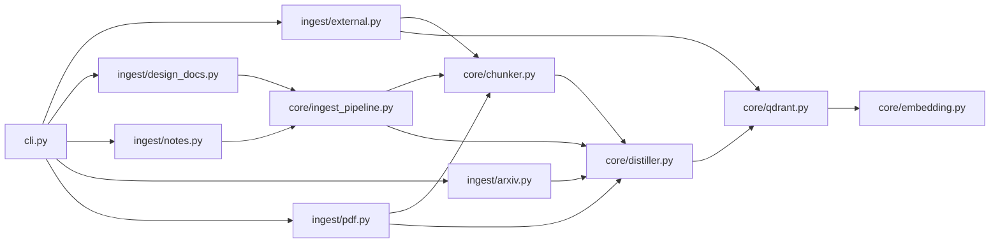

# doc-ingest design

## English

doc-ingest turns external API docs, own design docs, curated notes, arxiv papers, blog posts and
PDFs into vectors in [Qdrant](https://qdrant.tech/), so RAG / assistant tools can search them.
See [docs/spec/cli.md](spec/cli.md) for the command reference and
[docs/adr/README.md](adr/README.md) for recorded decisions.

### Layout and responsibilities

| Path | Responsibility |
|------|----------------|
| `cli.py` | click entry point (`doc-ingest`). Parses arguments, validates arxiv URLs, maps failures to exit codes, prints search results (control characters stripped). Holds no ingest logic. |
| `core/` | Shared building blocks, no source-specific knowledge. `config.py` (one frozen `Settings` from `.env`/environment), `schema.py` (collection names, payload shape, origin lookup), `chunker.py` (markdown and plain-text chunking, per-document chunk cap), `distiller.py` (LLM summarisation), `embedding.py` (HTTP embedding with fallback and retry), `qdrant.py` (thin client: upsert, search, `replace_points`), `ingest_pipeline.py` (shared flow for design/notes), `path_guard.py` / `doc_key.py` / `url_guard.py` (input safety and identity), `html.py`, `git.py`, `ids.py`, `retry.py`, `redact.py`, `nugget.py` (BM25 sentence extraction for `search --nugget`). |
| `ingest/` | One module per source: `external.py` (sync), `design_docs.py`, `notes.py`, `arxiv.py`, `pdf.py`. Each decides what to fetch, how to chunk, which distiller to use and which collection to write. |
| `sources/` | `external.yaml`: the list of external doc URLs (type, `check_interval`, tags, optional `render`). Run state (ETag, last sync, failure time) is kept in `sources/external.state.yaml`, which is not tracked. |
| `scripts/` | Operational shell/Python helpers: git hook installers (`install-hooks.sh`, `install-precommit.sh`), `migrate_doc_keys.py` (one-off migration after #216), `precommit-metrics/` (hook result logging), `systemd/` and a deploy script for a self-hosted setup. |
| `tests/` | pytest suite (network and services mocked). |
| `errors/` | Notes on past failures (system / tooling). |
| `docs/` | Specification (`spec/`), this document and ADRs (`adr/`). |

### Data flow

Edges that leave the process: `core/distiller.py` calls a local llama-server and, only for
public sources, Anthropic; `core/embedding.py` calls the HTTP embedding service;
`core/qdrant.py` calls Qdrant; `ingest/external.py`, `ingest/arxiv.py` and `ingest/pdf.py`
fetch over HTTPS through `core/url_guard.py`.

The flow differs per source:

| Source | Fetch | Chunk | Distil | Write |
|--------|-------|-------|--------|-------|
| `external` (`sync`) | HTTPS via `safe_get` (optionally through the Jina reader when `render: true`), ETag / `If-None-Match`, HTML to markdown | `chunk_markdown`, sections capped at 300 tokens | none: raw chunks are embedded (public documents) | `replace_points` keyed on `source_url` |
| `design`, `notes` | local `.md` files: the FILE argument, or files changed in the last commit | `chunk_markdown` | per chunk, local LLM only; a failed chunk is skipped | `replace_points` keyed on `file_path`; ids of failed chunks are kept (`keep_extra_ids`) |
| `arxiv` | arXiv API (+ first part of the PDF), or a blog page | none: one point per paper/page | whole abstract/body in one call (local, then Anthropic) | plain `upsert` (point id derived from the arxiv id or URL) |
| `pdf` | local file or HTTPS URL | `chunk_text` | per chunk, local LLM; Anthropic fallback only for URLs or with `--allow-cloud`; a `DistillError` is not caught per chunk | `replace_points` keyed on `doc_id` |

`replace_points` (core/qdrant.py) fetches the old point ids, upserts the new points (embedding
happens inside `upsert`), and only then deletes old ids that are not in the new set, so a failed
distillation, embedding or upsert leaves the previous data in place. Point ids are deterministic
(`core/ids.py`, SHA-256 based), so re-ingesting overwrites instead of duplicating.

### External dependencies

- Qdrant (vectors, size 768, cosine; `ingested_at` datetime index created with the collection).
- An HTTP embedding service (`EMBED_URL`, optional `EMBED_FALLBACK_URL`) that serves
  multilingual-e5-base style vectors and applies the `passage:` / `query:` prefix from the request `mode`.
- A local llama-server (OpenAI-compatible `/v1/chat/completions`) for distillation.
- Anthropic API (optional, `ANTHROPIC_API_KEY`) as distillation fallback for public sources.
- Jina reader (`https://r.jina.ai/`) for JavaScript-rendered external sources marked `render: true`.
- Discord webhook (optional) for the sync summary.
- Python libraries: click, httpx, qdrant-client, pymupdf, tiktoken, anthropic, ruamel.yaml,
  trafilatura, python-dotenv (see `pyproject.toml`).

### Key constraints and why

- **Private sources never go to Anthropic.** `design` and `notes` call the distiller with
  `local_only=True`; if the local LLM fails the chunk raises `DistillError`. A local PDF is also
  local-only unless `--allow-cloud` is given. Reason: those documents may hold private content.
- **A failed distillation never falls back to raw text.** Distilled chunks that fail are skipped,
  not embedded as the original text (`core/distiller.py` raises `DistillError`; empty summaries are
  rejected). The exception is `external` sync, which by design embeds raw public documentation
  chunks without distillation. Existing points of a chunk that failed are kept, so a temporary
  outage does not lose data.
- **Untrusted documents.** Ingested text is wrapped in `<document>` tags with an instruction not to
  follow it, and repeated after the document (prompt-injection mitigation, not a guarantee).
  Each point stores a `trust` value (`internal` for design/notes, `external` otherwise) and
  `search` shows it.
- **Path checks for local markdown.** `core/path_guard.py` (`assert_safe_path`) restricts the
  `design` / `notes` FILE argument to `DOC_INGEST_BASE_DIR` (default: current directory). It is not
  applied to `pdf`. In the ingest pipeline, a file that is a symlink or resolves outside its git
  repo (`core/doc_key.py` `escapes_repo`) is not read; its points are removed instead.
- **Document identity.** `core/doc_key.py` keys documents as `<repo>/<path-in-repo>` (repo = main
  working tree name, so worktrees agree) so two repos' `CLAUDE.md` do not collide and hook runs
  (relative paths) match manual runs (absolute paths). `scripts/migrate_doc_keys.py` cleans points
  written before this scheme. Known limitation: the key uses only the repo's directory name, so two
  different repos whose directories have the same name (e.g. `~/a/forge` and `~/b/forge`) produce
  the same keys and overwrite each other's points. Workaround: give such repos different directory
  names. Adding a remote URL or root identifier to the key would change every existing key
  (re-ingest plus orphaned points), so it needs a migration and is not done yet. A symlink (including
  a dangling one) is removed by its own, unresolved key (`lexical_doc_key`), never its target's.
- **URL checks.** `core/url_guard.py` allows only `https` and only hosts whose every resolved
  address is globally routable (private, loopback, link-local, CGNAT, multicast, reserved, Teredo
  and NAT64 are refused). `safe_get` / `safe_download` re-check every redirect hop (max 5), connect
  only to addresses validated at connect time (prevents DNS rebinding), ignore proxy environment
  variables, and cap the body size (`MAX_DOWNLOAD_BYTES`).
- **Size limits.** `MAX_CHUNKS_PER_DOC`, `MAX_LOCAL_BYTES`, `MAX_DOWNLOAD_BYTES` bound the work an
  oversized or hostile input can cause.
- **Secrets stay out of logs.** `core/redact.py` strips URLs from exception text (a Discord webhook
  token once leaked this way); `.env` is parsed, never `source`d, by the hook scripts.
- **Embedding limits.** The e5 model has a 512-token window, so chunk sizes are capped (300 tokens
  for external docs) and embeddings are sent in batches (`EMBED_BATCH`).
- **Exit codes.** `design` / `notes` exit 1 when a file failed and `sync` exits 1 when a source failed, so
  callers (cron, CI) can notice; chunks skipped because distillation failed only warn. The git hooks
  deliberately ignore it (`|| true`). See [spec/cli.md](spec/cli.md).

---

## 日本語

doc-ingest は、外部 API ドキュメント・自前の設計ドキュメント・ノート・arxiv 論文・ブログ・PDF を Qdrant のベクトルとして登録し、RAG やアシスタントから検索できるようにします。コマンドは [docs/spec/cli.md](spec/cli.md)、設計判断は [docs/adr/README.md](adr/README.md) を参照してください。

### ディレクトリごとの責務

| パス | 責務 |
|------|------|
| `cli.py` | click のエントリポイント。引数の処理、arxiv URL の検査、終了コードへの対応、検索結果の表示(制御文字を除去)。取り込みロジックは持たない。 |
| `core/` | 取り込み元に依存しない共通部品。設定(`config.py`)、コレクション名と payload(`schema.py`)、チャンク分割(`chunker.py`)、要約(`distiller.py`)、埋め込み(`embedding.py`)、Qdrant クライアント(`qdrant.py`)、design/notes の共通フロー(`ingest_pipeline.py`)、入力検査(`path_guard.py` / `doc_key.py` / `url_guard.py`)、その他(`html.py` `git.py` `ids.py` `retry.py` `redact.py` `nugget.py`)。 |
| `ingest/` | 取り込み元ごとのモジュール(`external.py` `design_docs.py` `notes.py` `arxiv.py` `pdf.py`)。何を取得し、どう分割し、どの要約を使い、どのコレクションに書くかを決める。 |
| `sources/` | `external.yaml`: 外部ドキュメントの URL 一覧。実行状態(ETag・最終同期・失敗時刻)は追跡対象外の `external.state.yaml` に保存される。 |
| `scripts/` | 運用用スクリプト。git フックの導入、キー移行(`migrate_doc_keys.py`)、フック結果の記録、systemd・デプロイ用。 |
| `tests/` `errors/` `docs/` | テスト、過去の障害メモ、仕様・設計・ADR。 |

### データの流れ

上の mermaid 図のとおり、取得 → チャンク → 蒸留 → 埋め込み → Qdrant への upsert / 置換 の順に流れます。ソースごとの違いは上の表を参照してください。要点は次のとおりです。

- `external`(sync)は蒸留せず生チャンクを埋め込む(公開ドキュメントのため)。
- `design` / `notes` はチャンクごとにローカル LLM のみで要約し、失敗したチャンクは埋め込まず、旧 point も消さない(`keep_extra_ids`)。
- `arxiv` はチャンク分割せず 1 件 1 point を upsert する。
- `pdf` は `chunk_text` で分割し、`doc_id` 単位で置換する。
- `replace_points` は「旧 id を取得 → upsert → 新しい集合に無い旧 id を削除」の順で、途中で失敗しても旧データが残る。point id は決定的なので再取り込みは上書きになる。

### 外部依存

Qdrant、HTTP 埋め込みサービス(`EMBED_URL`、任意で `EMBED_FALLBACK_URL`)、ローカルの llama-server、Anthropic API(任意・公開ソースのみ)、Jina Reader(`render: true` のソース)、Discord webhook(任意)。

### 主要な制約と理由

- **非公開ソースは Anthropic に送らない**: `design` / `notes` は `local_only=True`。ローカル PDF も `--allow-cloud` が無い限りローカルのみ。
- **要約に失敗した生テキストを埋め込まない**: 失敗したチャンクはスキップ(`DistillError`)。ただし `external` は設計上、公開ドキュメントの生チャンクをそのまま埋め込む。
- **取り込んだ文書は信頼しない**: `<document>` で囲み、中の指示に従わないよう明記する(完全な防御ではない)。`trust` を point に保存し検索で表示する。
- **パス検査**: `core/path_guard.py` は `design` / `notes` の FILE 引数を `DOC_INGEST_BASE_DIR`(既定は cwd)配下に制限する。`pdf` には適用されない。パイプライン内では symlink やリポ外に解決されるファイルは読まず、その point を削除する(`escapes_repo`)。
- **文書の識別子**: `core/doc_key.py` が `<repo>/<リポ内パス>` で識別し、別リポの同名ファイルの衝突と、フック(相対)・手動(絶対)の不一致を防ぐ。既知の制約: key はリポのディレクトリ名しか使わないため、ディレクトリ名が同じ別リポ(例: `~/a/forge` と `~/b/forge`)は key が衝突し、互いの point を上書きする。回避策はリポのディレクトリ名を変えること。key にリモート URL やルートの識別子を足すと既存の全 key が変わる(再取り込みと旧 point の孤立)ため、移行手順とあわせて別途対応する。symlink(リンク切れを含む)は、リンク先ではなく symlink 自身の解決前の key で point を削除する(`lexical_doc_key`)。
- **URL 検査**: `core/url_guard.py` は https のみ、解決された全アドレスが公開アドレスの場合だけ許可。リダイレクトごとに再検査し、接続時に検証した IP にだけ接続(DNS rebinding 対策)、プロキシ環境変数は無視、本文サイズに上限を設ける。
- **上限と秘匿**: `MAX_CHUNKS_PER_DOC` `MAX_LOCAL_BYTES` `MAX_DOWNLOAD_BYTES` で入力による負荷を制限。例外メッセージ中の URL は `core/redact.py` で除去。フックは `.env` を `source` せず解析する。
- **終了コード**: `design` / `notes` は失敗ファイルがあれば 1、`sync` は失敗ソースがあれば 1(蒸留スキップのチャンクは警告のみ)。git フックは `|| true` で無視する。
